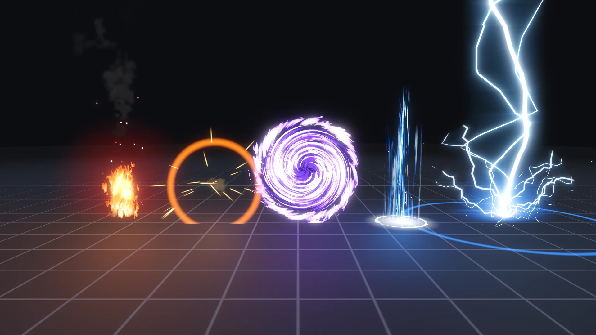

# Emberset Lite: 5 free 3D VFX for Godot 4

Five drop-in 3D effect scenes for Godot 4.3+, MIT licensed: **campfire, hit spark, arcane portal, lightning strike and rare loot beam**.

Everything is procedural: a few shaders and five small noise textures. No sprite sheets, no plugin to enable, no autoload.
Checked on Forward+, Mobile and Compatibility (web included).


*Rendered in Godot 4.7.2 (Forward+). Left to right: campfire, hit spark, arcane portal, rare loot beam, lightning strike.*

## Install

1. Copy `addons/emberset` into your project (keep the path, the scenes point at it).
2. Drag a scene from `addons/emberset/effects/` into your level. It plays.

To browse the five first, open this repository as a Godot project and press Play (`demo/gallery.tscn`).

## Use from code

```gdscript
const Campfire := preload("res://addons/emberset/effects/fire/campfire.tscn")

func light_fire_at(point: Vector3) -> void:
    var fx := Campfire.instantiate()
    add_child(fx)
    fx.global_position = point
```

Every scene has the same root script, `EmbersetEffect`:

| Member | What it does |
|---|---|
| `play()` / `stop()` | Start, or let it die out. |
| `finished` | Signal when a one-shot is done or a stopped loop has faded. |
| `one_shot` | True for bursts, false for loops. |
| `auto_free` | Free the node when it finishes. |
| `speed_scale` | Playback speed, 0.1 to 4. |
| `hue_shift`, `tint` | Recolour the whole effect. |

Effects look best with glow enabled in your `WorldEnvironment`.

## Want more?

These five come from the Emberset packs on itch.io. The full packs install into the same `addons/emberset` folder,
so these scenes keep working next to them.

- **[Emberset](https://jv18creator.itch.io/emberset)**: 388 scenes. Fire, impacts, muzzle flashes, projectiles, beams, lightning, portals, magic circles, orbs, ice, poison, smoke, dust, loot.
- **[Emberset Combat](https://jv18creator.itch.io/emberset-combat)**: 303 scenes. Slashes, hits, explosions, shields that react to hits, charge-ups, status effects that coat a character, flames, electric, elemental and dark magic, frosted glass.
- **[Both packs as a bundle](https://itch.io/s/217950/emberset-launch-bundle-691-godot-4-vfx)** (launch price until 1 December 2026).

I make these alongside a full-time job. When the Emberset packs reach 200 copies sold, I go full-time on Godot assets.

## Licence

MIT, see `LICENSE`. This covers the files in this repository only. The paid Emberset packs have their own licence.
